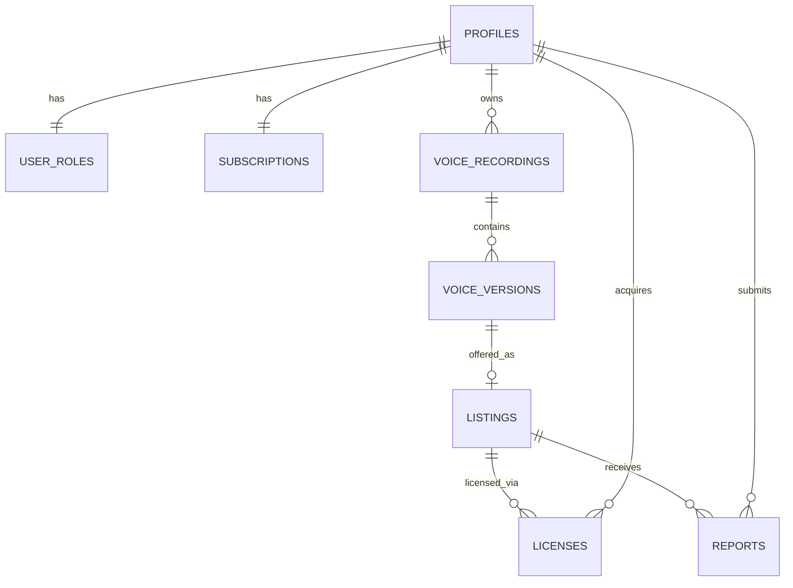

# EchoVault — Project Blueprint v1.0

**Проект:** SoftUni AI / Software Technologies with AI / Capstone Project  
**Тип:** Multi-page web app (MPA)  
**Статус:** Техническа спецификация за разработка; не е готово приложение  
**Стек:** HTML, CSS, Vanilla JavaScript, Bootstrap, Vite, npm, Supabase (Auth, PostgreSQL, Storage), Git, GitHub, Netlify  
**Основна идея:** Записване, обработване, съхраняване, публикуване и демонстрационно лицензиране на собствени аудиозаписи.

---

## 1. Съответствие със заданието на SoftUni

В Word заданието са посочени: HTML/CSS/JavaScript/Bootstrap; Node.js/npm/Vite; Supabase database/auth/storage; клиент–сървърна архитектура през REST API; многостранична навигация с отделни файлове; модулен код; `.github/copilot-instructions.md`; минимум 5 екрана; responsive дизайн; JWT auth, роли user/admin и RLS; минимум 4 свързани таблици, миграции в GitHub; upload/download; работещ публичен deployment; документация; **минимум 15 commits на поне 3 различни дни**. Самото приложение **не е задължително** да ползва AI — AI се използва в процеса на разработка.

| Критерий | Решение в EchoVault | Доказателство при защита |
|---|---|---|
| Архитектура | Vite MPA с отделни HTML и JS modules | Repo структура и преходи между страници |
| Екрани | 9 HTML страници | Навигация + responsive демонстрация |
| DB | 8 основни таблици | Supabase Table Editor + ER диаграма |
| Admin | `user_roles` + `admin.html` | Тестов admin акаунт |
| Auth | Supabase Auth + JWT | Register/Login/Logout |
| Security | RLS и защитени SQL RPC операции | Отрицателни тестове за чужд достъп |
| Storage | Частни аудиофайлове и публични previews | Upload и защитено download |
| Deployment | Netlify + Supabase | Live URL |
| Git | 18–23 смислени commits в поне 3 дни | Git log |
| Docs | README, ER схема, инсталация, demo accounts | GitHub README |

## 2. Обхват и приоритети

### 2.1 MVP — задължително за първата версия

- Регистрация, login, logout, session persistence и protected pages.
- Два вида роли: `user` и `admin`. Платеното членство е **абонаментен статус**, не роля.
- Standard: запис/качване/прослушване на оригинално аудио, лична библиотека, публикуване и Demo Buy/Rent.
- Premium: Muffle, Distortion и Echo; регулиране на интензитета; експорт и съхраняване на обработена версия.
- Съхраняване на оригинала независимо от обработените версии.
- Каталог, търсене по заглавие/категория, публичен preview, детайли за лиценз.
- Demo checkout: **без реални пари и без плащания**; създава лиценз и за покупка, и за 30-дневен наем.
- Администратор: преглед на потребители, скриване на обяви, обработка на сигнали, включване/изключване на **демонстрационен** Premium.
- RLS за таблиците и Storage; миграции; responsive UI; deployment.

### 2.2 Извън обхвата на MVP

Stripe/PayPal, реално разплащане и изплащане към автори, AI voice cloning, автоматизирана проверка на авторски права, time-stretch/pitch shift, сложни вериги от ефекти, social features, мобилни native apps.

### 2.3 Бизнес правила

1. За използване на платформата е необходим акаунт. Самата landing page може да бъде публична.
2. `free` e началният абонамент; `premium` се задава само през защитена администраторска операция.
3. Оригиналният запис е неизменим: нова обработка създава нов ред в `voice_versions` и нов файл.
4. Един запис има **точно една** оригинална версия; може да има много обработени версии.
5. Публикува се конкретна версия от запис; всяка обява предлага продажба, наем или и двете.
6. „Купуване“ = безсрочен **неизключителен лиценз за използване на конкретния файл**, не собственост върху гласа на автора.
7. „Наем“ = лиценз за 30 дни; след изтичане системата спира новото сваляне на файла, но не може да изтрие вече изтеглени копия.
8. Preview е отделен кратък файл и може да се прослушва без предоставяне на платения оригинал.
9. Архивирането на обява не отнема вече издаден лиценз. Не се позволява необратимо изтриване на файл с действащи или безсрочни лицензи.
10. Потребителят потвърждава, че има права и съгласие за публикувания глас; има бутон Report.

## 3. Роли и права

| Операция | Неавтентикиран | Standard | Premium | Admin |
|---|---:|---:|---:|---:|
| Landing page | Да | Да | Да | Да |
| Marketplace и previews | Не | Да | Да | Да |
| Записване/качване на оригинал | Не | Да | Да | Да |
| Запазване на оригинал | Не | Да | Да | Да |
| Ефекти и save/export на версия | Не | Не | Да | Само ако акаунтът има Premium |
| Публикуване и редакция на собствени обяви | Не | Да | Да | Да |
| Demo Buy / Rent | Не | Да | Да | Да |
| Download на платен файл | Не | Само собствен/лицензиран | Само собствен/лицензиран | По собственост/лиценз, освен при изрично модериране |
| Управление на чужди обяви и reports | Не | Не | Не | Да |
| Задаване на Premium статус | Не | Не | Не | Да |

**Забележка:** `admin` и `premium` са независими характеристики; администраторският интерфейс сам по себе си не активира платените аудио ефекти.

## 4. Екрани, компоненти и критерии за готовност

### 01 `index.html` — Landing page
- Header: лого, Login, Register.
- Hero: „Record. Transform. Share. License.“ и CTA „Get started“.
- Секции: How it works, features, plans; футър с Terms/Privacy (кратки прототипни текстове).
- **Готово когато:** има адаптивна версия, CTA води към Register, автентикиран потребител може да отиде към Dashboard.

### 02 `register.html` — Sign up
- Полета display name, email, password, confirm password, checkbox за права върху съдържанието/правила.
- Клиентска валидация + Supabase `signUp()` + обработка на email confirmation.
- **Готово когато:** създаден е Auth user и автоматично са създадени profile, user role, free subscription.

### 03 `login.html` — Sign in
- Email/password, loading/error, redirect към Dashboard, линк към Register.
- Logout от navbar; запазване на сесия.
- **Готово когато:** login/logout работят, неавторизираните заявки се отхвърлят.

### 04 `dashboard.html` — Dashboard
- Карти: My recordings, Edited versions, Active listings, My licenses.
- Списък с последни записи; CTA „Open Studio“; план Free/Premium.
- **Готово когато:** числата са реални заявки, empty/error/loading състояния са обмислени.

### 05 `studio.html` — Voice Studio
- Микрофон: permission, Record, Stop, Pause (ако има поддръжка), таймер.
- File upload като fallback; audio player и (по избор) waveform/нива.
- Оригинал: Save original, заглавие, категория, описание.
- Premium ефекти: Original/Muffle/Distortion/Echo, slider intensity, Preview effect, Reset, Save edited version.
- **Готово когато:** записва/качва, прослушва, запазва оригинал и след Premium проверка реален обработен WAV файл. Не трябва „ефектът“ да е само визуално състояние.

### 06 `marketplace.html` — Catalogue
- Responsive cards с preview, заглавие, категория, автор, вид ефект, цени.
- Search, category filter, price/license filter, empty state.
- **Готово когато:** показва само позволени публикувани обяви; preview е отделен публичен аудиофайл.

### 07 `voice-details.html?id=<uuid>` — Listing details
- Детайли за обявата, автор, дата, ефект, preview, Buy/Rent, license terms, Report.
- Demo checkout с потвърждение „No real money will be charged“.
- **Готово когато:** валидна лицензна операция се вижда в My Library; невъзможни операции дават ясна грешка.

### 08 `my-library.html` — User library
- Tabs: Original recordings / Edited versions / My listings / Acquired licenses.
- View, Save new version, Publish, Archive listing, Download original/licensed audio.
- **Готово когато:** потребителят може да управлява само своите записи и да изтегля само собствени или лицензирани файлове.

### 09 `admin.html` — Admin panel
- Таб: Users (read-only profile list + Set demo Premium); Listings (archive/restore); Reports (review/resolve).
- Route guard и сървърна проверка чрез RLS/RPC.
- **Готово когато:** обикновен потребител не може да отвори данни или да изпълни admin действия дори чрез директна API заявка.

**Общи UI компоненти:** `navbar`, `footer`, `toast`, `loading-spinner`, `confirm-dialog`, `audio-player`, `voice-card`, `empty-state`, `error-banner`, `premium-lock`. Всички екрани са HTML файлове; общите компоненти са JS функции/partial templates.

## 5. Архитектура и файлове

```text
echovault/
├── index.html
├── register.html
├── login.html
├── dashboard.html
├── studio.html
├── marketplace.html
├── voice-details.html
├── my-library.html
├── admin.html
├── vite.config.js
├── package.json
├── package-lock.json
├── .env.example
├── .gitignore
├── netlify.toml
├── README.md
├── docs/
│   ├── architecture.md
│   ├── er-diagram.md
│   ├── security-tests.md
│   └── demo-script.md
├── .github/
│   └── copilot-instructions.md
├── src/
│   ├── css/
│   │   ├── main.css
│   │   ├── studio.css
│   │   └── marketplace.css
│   ├── js/
│   │   ├── config/
│   │   │   └── supabaseClient.js
│   │   ├── pages/
│   │   │   ├── homePage.js
│   │   │   ├── registerPage.js
│   │   │   ├── loginPage.js
│   │   │   ├── dashboardPage.js
│   │   │   ├── studioPage.js
│   │   │   ├── marketplacePage.js
│   │   │   ├── voiceDetailsPage.js
│   │   │   ├── myLibraryPage.js
│   │   │   └── adminPage.js
│   │   ├── components/
│   │   │   ├── navbar.js
│   │   │   ├── voiceCard.js
│   │   │   ├── audioPlayer.js
│   │   │   └── notifications.js
│   │   ├── services/
│   │   │   ├── authService.js
│   │   │   ├── recordingService.js
│   │   │   ├── audioEngine.js
│   │   │   ├── storageService.js
│   │   │   ├── marketplaceService.js
│   │   │   ├── licenseService.js
│   │   │   ├── subscriptionService.js
│   │   │   └── adminService.js
│   │   └── utils/
│   │       ├── routeGuard.js
│   │       ├── validators.js
│   │       ├── formatters.js
│   │       └── fileValidation.js
│   └── assets/
│       └── logo.svg
├── supabase/
│   ├── migrations/
│   │   ├── <timestamp>_core_schema.sql
│   │   ├── <timestamp>_auth_bootstrap.sql
│   │   ├── <timestamp>_table_policies.sql
│   │   ├── <timestamp>_storage_policies.sql
│   │   └── <timestamp>_protected_rpcs.sql
│   └── tests/
│       └── rls_tests.sql
└── tests/
    ├── auth.test.js
    ├── audio.test.js
    └── market.test.js
```

**Vite MPA:** В актуалната документация на Vite 8 за multiple HTML entry points се използва top-level `input` в `vite.config.js` (или еквивалентен build entry в по-стари версии). Свери конфигурацията с реално инсталираната версия. Всяка HTML страница зарежда съответния `src/js/pages/...Page.js` с `<script type="module">`. Не се прави SPA router.

**Environment:** `.env.example` съдържа `VITE_SUPABASE_URL=` и `VITE_SUPABASE_PUBLISHABLE_KEY=`. Публичният publishable ключ е предназначен за браузъра, но **никога** не се поставят `sb_secret_...`, service-role key, JWT signing secret или Stripe secrets във `VITE_*` променливи/репото.

## 6. Данни — Supabase PostgreSQL

### 6.1 Основни таблици (8)

| Таблица | Полета и типове (основни) | Връзки / бележки |
|---|---|---|
| `profiles` | `id uuid PK`, `display_name text`, `avatar_path text nullable`, `created_at timestamptz`, `updated_at timestamptz` | `id → auth.users.id`; без публичен email |
| `user_roles` | `user_id uuid PK`, `role text CHECK ('user','admin')` | `user_id → profiles.id`; не се редактира от клиент |
| `subscriptions` | `user_id uuid PK`, `plan text CHECK ('free','premium')`, `expires_at timestamptz nullable`, `updated_at timestamptz` | Само trusted admin операция обновява план |
| `voice_recordings` | `id uuid PK`, `owner_id uuid`, `title varchar(120)`, `description text`, `category text`, `visibility text ('private','public')`, `created_at`, `updated_at` | `owner_id → profiles.id`; логически запис, не самият аудиофайл |
| `voice_versions` | `id uuid PK`, `recording_id uuid`, `effect_type text`, `effect_settings jsonb`, `storage_path text`, `duration_seconds numeric`, `mime_type text`, `file_size_bytes bigint`, `created_at` | `recording_id → voice_recordings.id`; оригинал + обработени версии |
| `listings` | `id uuid PK`, `version_id uuid UNIQUE`, `status text`, `sale_price_cents int nullable`, `rental_price_cents int nullable`, `rental_days int DEFAULT 30`, `currency char(3) DEFAULT 'EUR'`, `preview_path text`, `created_at` | `version_id → voice_versions.id`; активните обяви са в каталога |
| `licenses` | `id uuid PK`, `listing_id uuid`, `buyer_id uuid`, `license_type text ('buy','rent')`, `price_cents int`, `created_at`, `expires_at nullable` | `listing_id → listings.id`, `buyer_id → profiles.id`; само Demo Checkout RPC пише |
| `reports` | `id uuid PK`, `listing_id uuid`, `reporter_id uuid`, `reason text`, `status text`, `created_at`, `resolved_at nullable` | Потребителски сигнали и admin модерация |

`auth.users` е системна таблица на Supabase и **не** се брои като една от осемте приложни таблици.

### 6.2 Цялост на данните и индекси

- PK за всички таблици: UUID; FK колони с подходящи индекси.
- `voice_versions`: частичен unique индекс за `recording_id WHERE effect_type = 'original'` — най-много един оригинал.
- `listings`: уникален `version_id` за MVP (една обява за версия); поне една цена не-NULL; цените са положителни цели числа **в евроцентове**, не floating point.
- `licenses`: `buyer_id`, `listing_id`, `(buyer_id, listing_id)` индекси; уникална активна покупка от тип `buy` за една и съща обява.
- `voice_recordings`: `owner_id`, `visibility`, `created_at`; `listings`: `status`, `created_at`; `reports`: `status`, `reporter_id`.
- `voice_versions`: `file_size_bytes > 0`, `duration_seconds > 0`; само позволени аудио MIME типове; `storage_path` започва с `<owner_uuid>/`.
- Foreign-key поведение: не изтривай физически versions/listings с издадени лицензи. Архивирай обявите; използвай `ON DELETE RESTRICT` за връзки, които трябва да запазят история.
- Използвай `timestamptz` в DB и UTC като универсална времева зона; показвай локално време в UI.
- Дефинирай `CHECK` за `effect_type IN ('original','muffle','distortion','echo')`, `visibility IN ('private','public')`, `status IN ('draft','published','archived')`.
- Не разчитай на клиентски подадени цена, user ID, статус на план или срок на лиценз без сървърна проверка.

### 6.3 ER връзки (текстова диаграма)



### 6.4 Жизнен цикъл на записа

`record local` → `upload original to private Storage` → `create voice_recordings` → `create original voice_versions` → *(Premium)* `process audio locally → upload processed file → create edited version` → `create short preview in public preview bucket` → `create/publish listing` → `demo_checkout RPC` → `licenses` → `authorized download`.

Upload и записването на DB metadata не са една атомарна операция между Storage и PostgreSQL. Ако DB insert се провали след upload, клиентът трябва да изтрие собствения непубликуван „осиротял“ файл или да има периодична процедура за cleanup. При грешка показвай реалното състояние, не „Saved“.

## 7. RLS / авторизация — политика по политика

**Всички приложни таблици имат `ENABLE ROW LEVEL SECURITY`.** Отдели SQL миграции за таблици, bootstrap trigger, policies и protected RPC. Използвай `auth.uid()`, `TO authenticated`, точни `USING`/`WITH CHECK`; провери и SQL GRANT правата. Не използвай service role ключ в браузъра.

| Таблица | SELECT | INSERT | UPDATE | DELETE |
|---|---|---|---|---|
| `profiles` | Автентикирани потребители виждат публични профилни полета; admin може да вижда всички | Само bootstrap trigger | Само собственият профил (без ID) | Не директно |
| `user_roles` | Само собствената роля или admin | Само bootstrap/admin trusted SQL | Само trusted admin flow (не пряк клиентски UPDATE) | Не |
| `subscriptions` | Собствен план или admin | Само bootstrap trigger | Само защитена admin RPC | Не |
| `voice_recordings` | Собствените, публичните, или необходими за вече придобит лиценз | `owner_id = auth.uid()` | Само собственик; immutable `id`, `owner_id` | Само непубликувани/нелицензирани чрез контролиран flow |
| `voice_versions` | Собствени, версии на публични записи, или валиден лиценз | Собственик на родителски запис; за ефект ≠ original — активен Premium | Не: версиите са immutable | Само нереализирани версии без обяви |
| `listings` | Published + public source; собственик; admin; лицензиран купувач | Само собственик на версия, позволени цена/preview | Собственик или admin, но без смяна на `version_id`/`id` | Архивиране вместо физически DELETE |
| `licenses` | Само купувачът или admin | **Само защитен SQL RPC**, не чрез direct insert | Не | Не |
| `reports` | Само подателят и admin | Автентикиран подател; първоначален `open` | Само admin променя status/resolved_at | Не |

### 7.1 SQL примери — политики (насоки, не окончателна пълна migration)

```sql
-- Example: personal recordings.
alter table public.voice_recordings enable row level security;

create policy "Owners insert recordings"
on public.voice_recordings for insert to authenticated
with check (owner_id = (select auth.uid()));

create policy "Owners and users see public recordings"
on public.voice_recordings for select to authenticated
using (owner_id = (select auth.uid()) or visibility = 'public');

create policy "Owners update recordings"
on public.voice_recordings for update to authenticated
using (owner_id = (select auth.uid()))
with check (owner_id = (select auth.uid()));
```

**Важно:** последният пример сам по себе си не прави `owner_id` неизменим за всички възможни сценарии; добави ограничение/trigger за immutable полета, политика за лицензирани записи и тестове за достъп.

```sql
-- Example: private files are uploaded only in a user's own folder.
create policy "Users upload private audio in own folder"
on storage.objects for insert to authenticated
with check (
  bucket_id = 'voice-files'
  and (storage.foldername(name))[1] = (select auth.uid())::text
);
```

**Не предоставяй общ SELECT на всички `storage.objects` за `voice-files`!** При `SELECT` позволи достъп на собственика или на купувач с валиден лиценз за точно тази версия. За да избегнеш рекурсивни RLS зависимости между `listings`, `licenses` и `voice_versions`, тази проверка може да бъде капсулирана в много внимателно ограничена `private.can_access_audio_path(path text)` `SECURITY DEFINER` функция; SQL migration и тестовете трябва да проверяват и администраторския случай. При Storage downloads използвай authorized request или краткоживеещ signed URL.

### 7.2 Задължителни защитени функции

| RPC / helper | Вид | Правила |
|---|---|---|
| `private.is_admin()` | `SECURITY DEFINER` helper | Проверява `user_roles.user_id = auth.uid()` и `role='admin'` |
| `private.is_premium()` | helper | `subscriptions.plan='premium'` и `expires_at > now()` |
| `private.can_access_audio_path(path)` | helper | Път принадлежи на caller **или** има не-изтекъл лиценз за точно тази версия |
| `public.demo_checkout(listing_id, type)` | trusted RPC | JWT user, published listing, buyer ≠ seller, цена от DB, `type in ('buy','rent')`, предотвратяване на дублирана покупка; inserts `licenses` |
| `public.admin_set_premium(target_user, plan)` | trusted RPC | Caller трябва да е admin; 30-дневен demo Premium или free; без direct update от потребител |
| `public.admin_moderate_listing(listing_id, status)` | trusted RPC или строго RLS | Само admin, ограничени позволени преходи |

За `SECURITY DEFINER`: `SET search_path = ''`, schema-qualified идентификатори, `REVOKE EXECUTE FROM PUBLIC`, изричен `GRANT EXECUTE TO authenticated`, и отказ при `auth.uid() IS NULL`. Helper функциите се държат в **неекспонирана** схема `private`. `public` RPC функциите трябва да съдържат всички проверки, а не да разчитат на RLS, която тяхната definer роля може да заобикаля.

### 7.3 Примерна логика на `demo_checkout`

```text
INPUT: listing_id, requested_type = buy|rent
1. Resolve authenticated user ID from the verified JWT.
2. Read listing + immutable version + owner from DB.
3. Require status='published', parent recording public, requested price != NULL.
4. Deny seller buying own recording; deny duplicate permanent buy.
5. Determine price from DB, never from browser request.
6. For 'rent': expires_at = database now() + interval '30 days'.
   For 'buy': expires_at = NULL.
7. Insert licenses(buyer_id, listing_id, license_type, price_cents, expires_at).
8. Return created license ID; all checks and insert are transactional.
```

Това е **демонстрационна транзакция, не плащане**. UI надписът трябва да го казва ясно. При production checkout лиценз се издава **само след проверено сървърно потвърждение за плащане**.

### 7.4 Bootstrap след регистрация

След създаване на `auth.users` запис trusted DB trigger създава:
1. `profiles(id, display_name)`;
2. `user_roles(user_id, role='user')`;
3. `subscriptions(user_id, plan='free', expires_at=NULL)`.

Първият администратор се назначава от **trusted SQL/DB environment**, след като demo admin акаунтът е регистриран. **Няма** публичен admin registration endpoint.

## 8. Supabase Storage

| Bucket | Public? | Структура | Предназначение |
|---|---|---|---|
| `voice-files` | **Не** | `<user_uuid>/<version_uuid>.wav` или допустим записан формат | Оригинални и обработени файлове |
| `voice-previews` | **Да** | `<user_uuid>/<listing_uuid>.wav` | Кратък preview, не платен файл |

Правила: максимален размер за MVP примерно 20 MB; ограничения за MIME и продължителност (например максимум 2 минути); уникални имена; никога не използвай оригиналното потребителско име на файла като path; проверка на MIME/extension и в UI, и където е възможно в Storage bucket settings; без публични URL за full audio. В браузъра използвай `createSignedUrl` **само когато Storage policy разрешава това**; кратък срок (например 60 секунди) и коректно съобщение при изтекъл лиценз.

За previews: генерирай 5–8 секунди от разрешената за публикуване версия в браузъра и качи файла отделно. При много къси записи предупреждавай, че preview може да разкрие почти целия звук; за MVP може да изискваш минимум 12 секунди за платена обява.

## 9. Audio Engine — технически подход

### Запис
- `navigator.mediaDevices.getUserMedia({audio:true})`, с обработка на отказано разрешение.
- `MediaRecorder` с формат, избран чрез `MediaRecorder.isTypeSupported(...)`; не приемай, че всеки браузър поддържа `audio/webm`.
- Събиране на chunks → Blob → local preview → опционално нормализиране/конвертиране → upload.
- Освобождаване на `MediaStreamTrack` при stop/navigation; избягване на memory leaks.
- Алтернатива: upload на поддържан audio file.

### Ефекти с Web Audio API

| Режим | Реализация | Контрол |
|---|---|---|
| Original | Direct AudioBuffer pass-through | Няма |
| Muffle | `BiquadFilterNode` с `type='lowpass'` | cutoff frequency |
| Distortion | `WaveShaperNode` с curve + gain control | amount |
| Echo | `DelayNode` + feedback/gain | delay/mix/feedback |

**Audio processing vs export:** Live audio preview не е достатъчен. За запазване на версията рендерирай ефекта върху `AudioBuffer` чрез `OfflineAudioContext`, създай валиден WAV Blob (PCM encoding), upload в private bucket и metadata в `voice_versions`.

**Premium защита:** UI може да заключва controls, но запазването на запис с `effect_type != 'original'` се проверява в DB policy/helper. При реален комерсиален продукт premium обработката трябва да се извършва или проверява на доверен сървър — браузърният код може да се модифицира от клиента. За Capstone това е документирано ограничение.

## 10. Frontend services и интерфейс към Supabase

| Service | Отговорности |
|---|---|
| `authService.js` | register/login/logout/currentUser/getRole |
| `recordingService.js` | CRUD на metadata, list my recordings, insert version |
| `storageService.js` | upload original/edited/preview, authorized download, cleanup |
| `audioEngine.js` | permission, capture, decode, apply effects, WAV render |
| `marketplaceService.js` | list published, get by id, create draft/publish/archive, filters |
| `licenseService.js` | `supabase.rpc('demo_checkout',...)`, my licenses, access validity |
| `subscriptionService.js` | read plan, premium eligibility |
| `adminService.js` | list reports/users, moderate, update premium via admin RPC |

Примерна **форма** на API calls:

```js
// Client-side authenticated request, subject to RLS.
const { data, error } = await supabase
  .from('voice_recordings')
  .select('id,title,category,created_at')
  .eq('owner_id', user.id)
  .order('created_at', { ascending: false });

// Not a payment: a protected database RPC creates a demo license.
const { data: licenseId, error: checkoutError } = await supabase.rpc(
  'demo_checkout',
  { p_listing_id: listingId, p_license_type: 'rent' }
);
```

SQL RPC parameter names must match **exactly** when the function is implemented. Do not compute authorization from `localStorage` booleans; use Supabase session + DB policies.

## 11. Copilot работен цикъл и roadmap

### Начално правило за всяка задача

1. Избери една малка feature задача и дай един конкретен prompt на Copilot.
2. Прегледай предложените файлове и SQL, преди да ги приемеш.
3. `npm run dev`; провери основния и отрицателните сценарии.
4. `npm run build`; ако има DB промени — приложи migration и тествай RLS.
5. Commit и push **само на работеща стъпка**.
6. Не генерирай фалшиви commits; разпредели реалната работа в минимум три различни дни.

### Фаза A — основи (3–4 commits)

**A1. Init repo + Vite.** `npm create vite@latest echovault -- --template vanilla`; `npm install`; `npm install @supabase/supabase-js bootstrap bootstrap-icons`. Създай `.env.example`, `.gitignore`, README skeleton.  
**Приемане:** `npm run dev` и `npm run build` работят.

**A2. Multi-page shell.** 9 HTML entry points, Bootstrap header/footer, links, mobile menu. Добави правилно multi-page build input.  
**Приемане:** всички 9 URL работят локално и след `npm run build`.

**A3. Supabase client + agent instructions.** Един Supabase client module, config validation, Copilot instructions.  
**Приемане:** има централизирано и чисто свързване към backend без секретни ключове.

### Фаза B — Auth и данни (4 commits)

**B1. Core migration.** Направи 8 таблици, constraints, индекси, relationship и ER диаграма.  
**Приемане:** миграциите се прилагат от нула, схемата има FK и ограничения.

**B2. Signup bootstrap.** Trigger създава profile, user role, free subscription.  
**Приемане:** нов акаунт има три последователни записа.

**B3. Register/Login/Logout + route guards.**  
**Приемане:** protected page пренасочва без сесия; auth грешките са обработени.

**B4. Core RLS + negative tests.**  
**Приемане:** User B не може да модифицира записи на User A; никой не може да си даде admin/Premium.

### Фаза C — Audio и Storage (4 commits)

**C1. Audio recording.** Record/Stop/Play; permission/error handling.  
**Приемане:** потребителят записва и чува гласа си.

**C2. Private file upload.** Storage buckets, policies, upload original.  
**Приемане:** файлът реално съществува в Supabase, само собственикът има достъп.

**C3. Recordings metadata + My Library.** Save/list original versions.  
**Приемане:** ново зареждане на страницата показва съхранения запис.

**C4. Authorized download.**  
**Приемане:** собствен файл се изтегля; чужд частен файл дава отказ.

### Фаза D — Audio effects и Premium (3–4 commits)

**D1. Muffle, Distortion, Echo live preview.**  
**Приемане:** може на слух да се установи промяна.

**D2. Offline export + edited version.**  
**Приемане:** генериран WAV се възпроизвежда след download и при ново отваряне.

**D3. Premium checks + protected save.**  
**Приемане:** Standard не може да създаде edited version чрез директна API заявка, а Premium може.

**D4. Optional UX polish.** Level meter, waveform, Reset, error messages.

### Фаза E — Marketplace и licensing (4 commits)

**E1. Create listing + preview.**  
**Приемане:** собствената public версия може да се предложи с цена; full audio остава private.

**E2. Marketplace UI + details.**  
**Приемане:** filter/search, preview и details работят.

**E3. Secure Demo Buy/Rent RPC.**  
**Приемане:** лицензът се записва с server-calculated price и правилна expiry дата.

**E4. My Licenses и защитен download.**  
**Приемане:** лицензиран потребител може да изтегли, нелицензираният получава отказ, изтекъл наем не дава нов download.

### Фаза F — Admin и security (2–3 commits)

**F1. Admin role seed и Admin Panel.**  
**Приемане:** admin вижда reports/listings, user няма достъп.

**F2. Reports + moderation.**  
**Приемане:** signal/resolve/archive без пряк unauthorized update.

**F3. Demo Premium admin RPC.**  
**Приемане:** Premium не може да се активира от user; admin може да го зададе.

### Фаза G — QA, публикация и защита (3 commits)

**G1. Responsive + accessibility + error states.** Keyboard labels, focus, mobile viewports.  
**G2. Security regression.** Cross-user read/write; expired rental; file path guessing; role escalation; invalid MIME.  
**G3. Netlify + README + demo accounts + screenshots/demo script.** `npm run build`, production env vars, working URLs.

Приоритет при недостиг на време: **B → C → F → G (покриване на оценяването) → D → E**. Ако не остане време за пълния пазар, осигури поне работещи Auth, Storage, CRUD, Admin, RLS и deployment.

## 12. Acceptance / тестови сценарии

| ID | Сценарий | Очакван резултат |
|---|---|---|
| T01 | Guest отваря `studio.html` | Login redirect |
| T02 | Нова регистрация | Auto profile + role=user + free subscription |
| T03 | User A качва audio | Файл в `voice-files/<A>/...`, metadata записани |
| T04 | User B чете private recording A | Access denied |
| T05 | User B сваля private voice file A | Access denied |
| T06 | Standard запазва edited version чрез forged DB API request | Denied |
| T07 | Premium запазва Muffle version | Нов Storage file + voice_versions row |
| T08 | Listing се публикува с preview | Preview работи; full file не е публичен |
| T09 | Checkout price се манипулира в browser | DB използва собствената цена, не клиента |
| T10 | User се опитва да зададе `role=admin` | Denied |
| T11 | User се опитва да зададе `plan=premium` | Denied |
| T12 | Buy license от User B | Достъпът се записва; download allowed |
| T13 | Rent license след изтичане | Нов download denied |
| T14 | Seller архивира обява с издаден license | Историческият лиценз продължава да работи |
| T15 | Regular user извиква admin RPC | Denied |
| T16 | Admin архивира проблемна обява | Премахната от общия каталог |
| T17 | Сайт на mobile viewport | Без хоризонтален scroll и счупени контроли |
| T18 | Production reload на всяка HTML страница | Няма 404 и broken asset paths |
| T19 | GitHub repo | >=15 смислени commits в >=3 дни |
| T20 | Production | Работещ live URL + demo user/admin credentials |

Тестовите акаунти да са **специално създадени demo accounts**, без лични данни и със сменяеми пароли. Никога не публикувай service key или реални потребителски credentials.

## 13. Netlify deployment

1. `npm run build` и преглед на `dist/`.
2. В Netlify: import GitHub repo; build command `npm run build`; publish directory `dist`.
3. Env vars: `VITE_SUPABASE_URL`, `VITE_SUPABASE_PUBLISHABLE_KEY` (публичен ключ, **не secret**).
4. В Supabase Auth настрой Site URL и allowed redirect URLs за production домейна (и за local dev според нуждата).
5. Приложи DB миграциите към свързания production Supabase проект и провери RLS/Storage policies.
6. Провери всеки от 9-те отделни HTML URLs, login/logout, recording (HTTPS), uploads/downloads и admin.
7. Добави live URL в README и полетата на заданието.

**Миграции:** използвай Supabase CLI; миграциите в `supabase/migrations` се commit-ват, а не се правят само ръчни промени в dashboard. Ако remote DB е изменяна ръчно, извърши `supabase db pull --remote` и синхронизирай историята, преди да добавяш нови миграции.

## 14. README / документация

Трябва да съдържа:
- Project overview и мотиви;
- Features, user roles и limitations (Demo checkout ≠ real payment);
- Tech stack и client/server diagram;
- ER диаграма и обяснение на таблиците;
- Security model, RLS, private/public Storage;
- Local development: prereqs, `npm install`, env vars, `npm run dev`;
- Supabase migrations: CLI setup, db reset/push, demo seed;
- Deployment link;
- Тестови credentials (само demo user и demo admin, не production secrets);
- Screenshot-и от 5+ екрана;
- Known issues, future development;
- Как е използван GitHub Copilot.

## 15. Сценарий за 5-минутна защита

1. Покажи Landing, Register и Login.
2. Влез с demo Free user; запиши и запази оригинално аудио.
3. Покажи, че аудио ефектите са Premium-only.
4. Влез с demo Premium user; Muffle → Save edited version → покажи нова версия.
5. Публикувай версия с preview и цена; отвори Marketplace.
6. Влез с втори user; Demo Rent → My Licenses → authorized download.
7. Влез като Admin; покажи reports и archive listing.
8. Покажи Supabase таблици, private/public buckets, RLS deny тест, GitHub commits и Netlify URL.

## 16. Критерии за Definition of Done

- [ ] 9 HTML страници, адаптивни за desktop и mobile.
- [ ] Работещи register/login/logout и JWT сесии.
- [ ] 8 таблици, миграции, ключове, индекси и ER диаграма.
- [ ] Trigger за user profile, role, subscription.
- [ ] RLS + проверени deny тестове.
- [ ] Recording + upload + лична библиотека + download.
- [ ] Muffle/Distortion/Echo с истинска аудиообработка + export.
- [ ] Premium check на backend ниво за запазване на edited versions.
- [ ] Marketplace, previews, details, Demo Buy/Rent, purchased/rented access.
- [ ] Admin panel, moderation и demo Premium control.
- [ ] GitHub >=15 commits в >=3 дни.
- [ ] Netlify live deployment и demo credentials.
- [ ] README, setup, архитектура и screenshots.

## 17. Рискове, ограничения и решения

- **Voice rights/privacy:** Изисквай изрично потвърждение от автора; не включвай voice cloning; добави Report flow и процедура за премахване на незаконно съдържание.
- **Няма реални плащания:** Моделът е лицензиране с демонстрационна транзакция; production checkout изисква проверен payment webhook.
- **Client-side premium:** JavaScript ефектите могат да се заобиколят; backend трябва поне да валидира edited metadata/Storage permissions, а production обработката да стане trusted.
- **Browser compatibility:** MediaRecorder форматът варира; използвай MIME capability check и upload fallback.
- **Preview leak:** Публичен preview отделен от full private audio, изрично ограничена продължителност.
- **Subscription expiry:** Използвай `expires_at > now()` в DB, не browser clock.
- **Immutable licenses:** Архивирай обяви, не изтривай аудио с издадени лицензи.
- **Costs/limits:** Проверявай актуалните лимити на Supabase и Netlify, ограничи големината и броя тестови файлове.

## 18. Официални справочни източници

- Изисквания: приложеното SoftUni Word задание *Soft-Tech-with-AI-Capstone-Project.docx*.
- Supabase RLS: https://supabase.com/docs/guides/database/postgres/row-level-security
- Supabase Storage access control: https://supabase.com/docs/guides/storage/security/access-control
- Supabase migrations: https://supabase.com/docs/guides/local-development/database-migrations
- Supabase database functions: https://supabase.com/docs/guides/database/functions
- Vite multi-page apps: https://vite.dev/guide/build.html#multi-page-app
- MDN MediaRecorder: https://developer.mozilla.org/en-US/docs/Web/API/MediaRecorder
- MDN OfflineAudioContext: https://developer.mozilla.org/en-US/docs/Web/API/OfflineAudioContext

---

*Проектният Blueprint е план за имплементация. Примерните SQL/RLS фрагменти не представляват изцяло изпълнена и тествана SQL migration; генерираните от Copilot migrations трябва да се изпълнят и тестват в реален Supabase проект.*
