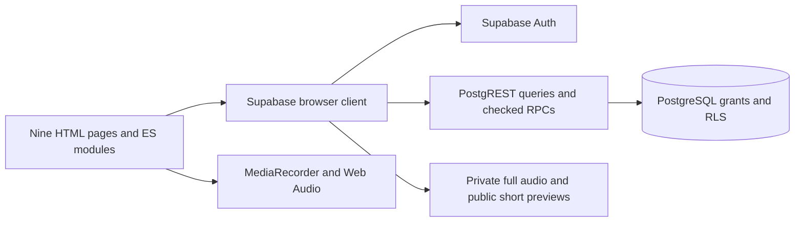

# EchoVault

EchoVault is a SoftUni AI Capstone application for recording, transforming,
storing and demo-licensing consented voice recordings. Its purpose is to combine
real browser audio processing with persistent data, authentication and server-side
authorization while keeping original audio separate from edited versions.

The application uses HTML5, CSS3, vanilla JavaScript ES modules, Bootstrap 5,
Vite/npm and Supabase Auth, PostgreSQL and Storage. It is a multi-page application
with nine distinct HTML entries, not an SPA. **Demo Checkout never charges money.**

## Features and permissions

- Email/password registration, optional email confirmation, persistent sessions,
  logout and protected pages.
- Real microphone recording with MIME support checks, permission feedback and
  file-upload fallback; private original saves and a persistent personal library.
- Premium Muffle, Distortion and Echo with intensity, audible preview, Reset and
  real OfflineAudioContext WAV export to new immutable versions.
- Authenticated Marketplace search/filter/details, separate 5–8 second public
  previews, euro-cent demo offers and rights/public-metadata confirmations.
- Server-controlled Demo Buy and 30-day Demo Rent, price snapshots and private
  full-audio playback/download for owners or valid license holders.
- User reports and admin-only users/listings/reports, archive/restore, resolution
  and demo Premium/Free tools.
- Dashboard with exact own-recording/edited-version/published-listing/license
  counts, five recent recordings and a plan checked against database time.

| Account | Permissions |
|---|---|
| Guest | Landing, Register and Login; protected screens require sign-in |
| `user` with Free | Record/upload originals, manage own library/listings, browse, report and demo-license permitted offers |
| `user` with active Premium | Free features plus effect export/save, subject to server-side Premium checks |
| `admin` | Moderation and demo-plan tools; private audio still requires ownership or a valid license |

`admin` is a role; `premium` is a subscription plan. Neither signup metadata nor
editable browser flags can grant either. Demo accounts and credentials are
**PENDING**; see [demo account preparation and private handover](docs/demo-accounts.md).

## Architecture and data



The [architecture guide](docs/architecture.md) explains modules, data flows and
security boundaries. The [ER diagram](docs/er-diagram.md) documents all eight
application tables: `profiles`, `user_roles`, `subscriptions`, `voice_recordings`,
`voice_versions`, `listings`, `licenses` and `reports`. The Marketplace metadata
projection is a view, not another application table.

All eight tables enable RLS. Checked SQL RPCs derive identity from `auth.uid()`,
prices from stored offers and expiry from DB time. `voice-files` is private;
`voice-previews` is intentionally public. Marketplace metadata never supplies a
private full-audio URL. Originals are not overwritten, and archival preserves
existing valid licenses and media relationships. Migrations are versioned under
[`supabase/migrations`](supabase/migrations).

The nine pages are `index.html`, `register.html`, `login.html`, `dashboard.html`,
`studio.html`, `marketplace.html`, `voice-details.html?id=<uuid>`,
`my-library.html` and `admin.html`. Each has its own page module under
`src/js/pages/`; shared components, services, utilities and styles are separate.

## Local setup

Prerequisites: Git, npm and Node.js **22.12 or newer**. Netlify pins Node
**22.x** in `netlify.toml`, allowing its current maintenance patches. An isolated local Supabase also needs a supported
Docker runtime; use the repository's installed Supabase CLI through `npx`.

```powershell
npm.cmd ci
if (-not (Test-Path -LiteralPath .env.local)) {
  Copy-Item -LiteralPath .env.example -Destination .env.local
}
```

On other shells use `npm`/`npx` and copy the environment file with your shell's
equivalent command. Edit the ignored `.env.local` before opening the app, supplying
only these browser-safe values:

```dotenv
VITE_SUPABASE_URL=
VITE_SUPABASE_PUBLISHABLE_KEY=
```

Use an isolated local stack or the verified development project **echovault-dev**,
reference **`zysyghbbbesatbehravb`**. Its hosted URL is
`https://zysyghbbbesatbehravb.supabase.co`. Never use the separate primary
**echovault** project. Do not print/copy existing private environment contents into
logs or documentation. Use a browser-safe publishable key, not a secret,
service-role, signing or payment key. The client rejects legacy JWT-format keys;
if a local CLI only supplies legacy keys, resolve publishable-key compatibility
before attempting local browser flows.

Vite loads environment values at startup/build time: restart the dev server or
rebuild after changing them. Without valid config the UI reports configuration
errors instead of pretending Supabase features work. After setting the values:

```powershell
npm.cmd run dev
```

The usual dev URL is `http://localhost:5173`; check the actual port printed by
Vite.

### Isolated local database and Auth

For a **new/disposable local stack only**, with Docker running:

```powershell
npx.cmd supabase start
npx.cmd supabase status
```

Use the local API URL and its browser-safe publishable key in `.env.local`.
Existing migrations create schema, policies, buckets and protected functions.
If the disposable local database must be recreated deliberately:

```powershell
npx.cmd supabase db reset --local
```

`db reset --local` erases/recreates **local** database contents; use it only for
disposable fixtures. Do not run a remote reset/push or old cleanup/live attack
scripts. This Prompt 18 execution does not apply remote migrations or modify
remote data. The checked-in local config disables seeding because no seed file is
provided; demo personas are prepared explicitly using
[the account guide](docs/demo-accounts.md). The
[manual admin bootstrap](supabase/manual/bootstrap_demo_admin.sql) is disabled by
null UUID/email placeholders and must stay disabled in the repository.

Local Auth uses Site URL `http://localhost:5173` and allows the configured
localhost/127.0.0.1 dev/preview URLs on ports 5173/4173. Local email confirmations
are disabled by default; the UI supports a confirmation-required project too.
Signup sends only display-name metadata and no explicit email redirect override,
so confirmation follows the configured Supabase Site URL. See
[deployment and Auth setup](docs/deployment.md) before any authorized hosted use.
The [confirmation-email template](docs/email-templates/confirm-signup.html) is
local source only and has not been applied by these changes.

## Build and validate

```powershell
npm.cmd test
npm.cmd run test:prompt18
npm.cmd run build
npm.cmd run test:build
npm.cmd run check:syntax
git diff --check
npm.cmd run preview
```

The safe offline suite excludes old live API attack/cleanup scripts. The
Prompt 18 checks cover final source/config/documentation contracts;
`test:build` needs current `dist` output. Vite builds all nine pages into `dist`;
preview normally serves `http://localhost:4173`. These commands do not deploy or
prove live Auth/RLS/Storage/browser behavior. Record actual results and failures
rather than inferring PASS from this command list.

Use the [T01–T20 test checklist](docs/test-checklist.md),
[five-minute demo script](docs/demo-script.md) and
[deployment readiness guide](docs/deployment.md). Earlier focused validation
records remain in `docs/prompt12-validation.md` through
`docs/prompt17-validation.md` where present. They describe their original execution
dates and limits, not a new live verification.

The [Prompt 18 validation report](docs/prompt18-validation.md) records executed
PASS/SKIP results, remaining acceptance work and the complete changed-file list.

## Release evidence and remaining work

- **Production URL: PENDING.** No deployment is performed by this milestone's
  local execution. Netlify is configured for `npm run build`, `dist` and Node
  22.x, with real HTML entries and no SPA fallback.
- **Demo credentials: PENDING.** Supply verified purpose-created demo-only access
  privately, following [the handover guide](docs/demo-accounts.md).
- **Screenshots: PENDING.** Capture actual views from at least five pages,
  including a mobile view, and add their real files/links after capture. Never use
  mock screenshots as proof of working features.
- **Runtime acceptance: PENDING until observed.** Execute isolated local
  SQL/RLS/direct API and desktop/mobile/audio tests, then hosted URL/reload/Auth
  checks after separately authorized release. Distinguish PASS, FAIL and SKIP.
- Review genuine Git history for 15+ meaningful commits over 3+ calendar days.
  Do not fabricate history. Prompt 18 does not automatically commit or push.

## Limits and future work

There are no real payments/payouts, voice cloning or automated rights verification.
Users must have permission for shared voices. SQL checks metadata and ownership
but cannot independently decode/trust browser-generated audio; a commercial
service would need trusted media validation/processing. Short-source previews may
reveal most audio, so use 12+ second consented demo samples. Public previews remain
public after archive. Rental expiry prevents new server downloads but cannot erase
already downloaded copies. Microphone/audio-format support varies by browser and
requires HTTPS or localhost. A future production product needs dedicated payment,
media validation and rights-management work outside this Capstone scope.

## AI-assisted development

The repository contains
[GitHub Copilot instructions](.github/copilot-instructions.md) and the
[incremental prompt plan](EchoVault_Copilot_Prompts.md). Their presence does not
prove which historical changes were made with Copilot; the author should describe
actual historical use from their own records. Codex assisted the Prompt 18 local
audit, focused fixes, documentation and validation work. Generated changes still
require source review and observed test evidence; no Git history or test results
should be invented.
