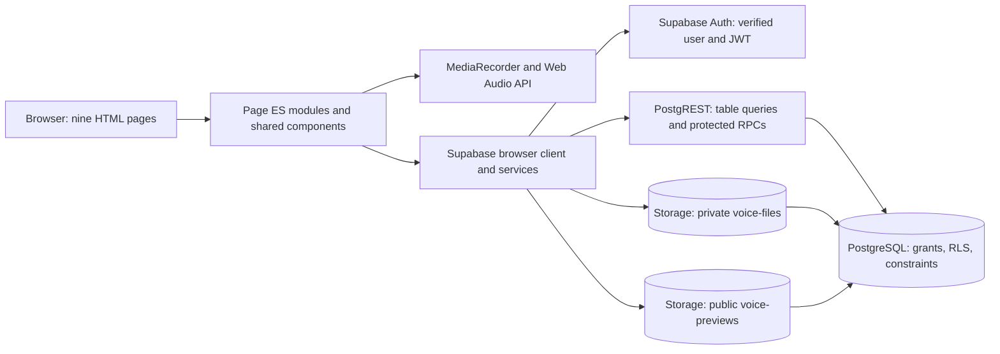

# EchoVault architecture

EchoVault is a SoftUni Capstone multi-page application for recording, editing,
storing and demo-licensing consented voice recordings. Demo Checkout never charges
money. This document describes the checked-in implementation; it does not certify
that a particular remote database has every migration or that browser acceptance
tests have passed.

## Client and server

Vite builds the nine explicit HTML inputs in `vite.config.js`. Each HTML entry
loads its own `src/js/pages/*Page.js` module. Navigation uses page URLs rather
than an SPA router. Bootstrap 5 and the shared sage-green/white styles provide
responsive layout; vanilla JavaScript handles behavior. There is no custom
Node/Express application server, frontend framework or TypeScript runtime.

The browser uses only `VITE_SUPABASE_URL` and
`VITE_SUPABASE_PUBLISHABLE_KEY`. Supabase Auth supplies the signed session token;
the publishable key alone does not authorize protected data. Server-side grants,
RLS and checked PostgreSQL functions enforce permissions. A route guard or hidden
button is only a user-interface safeguard.

## Pages and modules

| HTML entry | Main responsibility |
|---|---|
| `index.html` | Public introduction, plans and registration/login navigation |
| `register.html` | Validated signup, rights/rules acknowledgement and email-confirmation feedback |
| `login.html` | Sign-in, safe internal return URL and session/error feedback |
| `dashboard.html` | Exact own-data counts, five recent recordings, DB-checked plan and Studio/Library links |
| `studio.html` | Microphone/file input, immutable original save, Premium effects and WAV export |
| `marketplace.html` | Authenticated listing search, filters and separate public previews |
| `voice-details.html?id=<uuid>` | Listing details, Demo Buy/Rent and report creation |
| `my-library.html` | Own originals/edited versions/listings and acquired licenses |
| `admin.html` | DB-role-guarded users, listings, reports and demo Premium tools |

`src/js/components/` contains the navbar/footer, listing publisher/cards,
checkout, licensed-audio UI, report form and admin panel. Page modules coordinate
these components. Services isolate API and media operations; utilities validate
audio, listing options, filters, safe redirects and upload diagnostics. CSS is
shared in `main.css` with Studio, Marketplace and Library additions.

Key service boundaries:

- `authService.js` and `routeGuard.js` verify a user with Auth before protected
  content is revealed. Admin navigation reads the caller's database role.
- `recordingService.js` owns microphone permission, MIME negotiation, recording
  lifecycle and track cleanup. Permission is requested after user action.
- `audioEngine.js` implements real low-pass Muffle, WaveShaper Distortion and
  Delay/feedback Echo, previews and OfflineAudioContext PCM WAV rendering.
- `voiceRecordingService.js`, `storageService.js` and `editedVersionService.js`
  coordinate metadata, unique private uploads and uncertain-save recovery.
- `marketplaceService.js` creates separate previews, publishes through a checked
  RPC, lists permitted metadata and archives owned listings.
- `licenseService.js` sends only listing ID and license type to Demo Checkout.
  `licensedAudioService.js` resolves the exact licensed version and fetches its
  private bytes after Auth and RLS checks.
- `subscriptionService.js` asks `has_active_premium()`; it does not grant access
  from a browser clock or editable plan flag.
- `dashboardService.js` requests exact owner/buyer-scoped counts and five recent
  recordings. `dashboardOverview.js` combines those results with DB Premium
  eligibility and clears stale account data on authentication changes.
- `adminService.js` and `reportService.js` invoke checked moderation/report RPCs.
  They never use an elevated key or give administrators blanket audio access.

## Data flows and authorization

1. **Signup:** Auth creates a user. A trusted trigger creates its profile,
   `user` role and `free` subscription. Signup metadata supplies a display name,
   never authority to select a role or plan. First-admin bootstrap is a separate,
   deliberately disabled trusted SQL template.
2. **Original save:** the client validates supported MIME, nonempty audio and
   the 20 MiB limit, uploads with `upsert: false` to an authenticated user folder,
   then calls `create_original_voice_recording`. The RPC validates the owned
   object and creates recording/original metadata atomically. A partial unique
   index allows at most one original; the creation transaction supplies one.
   Cleanup is restricted to owned, unreferenced uploads; uncertain results are
   reconciled before removal or retry.
3. **Edited save:** actual OfflineAudioContext output becomes a new WAV object
   and `voice_versions` row. The original remains unchanged. Server-side policies
   enforce ownership, metadata/object requirements and active Premium evaluated
   using database time.
4. **Publishing:** `publish_voice_listing` requires owned private source audio,
   explicit rights/public-metadata confirmations, positive euro-cent offer(s)
   and a separate 5–8 second preview. The preview is mono PCM16 16000 Hz WAV in
   `voice-previews`; full audio stays in `voice-files`. Publication makes source
   recording **metadata** public to authenticated readers, not the full audio.
5. **Marketplace:** `marketplace_listing_summaries` is an authenticated-only,
   owner-executed security-barrier view with explicit published/public/preview
   predicates. It exposes seller/listing metadata and preview paths, never
   `voice_versions.storage_path`. This controlled projection permits browsing
   without granting arbitrary private-version reads.
6. **Demo Checkout:** `demo_checkout(p_listing_id, p_license_type)` obtains buyer
   identity from `auth.uid()`, seller and prices from stored relationships, and
   timestamps from the database. It locks/rechecks the offer, denies self-buy and
   duplicate permanent purchases, records a price snapshot, and sets rent expiry
   to 30 days. Retrying an active rental returns the existing receipt without
   extending expiry. There is no payment-provider integration.
7. **Playback/download:** owners or a buyer with a valid license can read the
   exact private object. Rent validity uses DB `now()`. Delivery uses an
   authenticated Storage download followed by a local Blob URL, not a public or
   bearer signed full-audio URL. Storage rechecks access at download time; the
   client discards a result if its verified account changed while loading.
8. **Moderation:** authenticated reporters submit validated reasons through
   `create_listing_report`; duplicate reporter/listing pairs are serialized.
   Admin RPCs check the caller's stored `admin` role before listing users,
   listings/reports, resolving a report, archiving/restoring an offer, or assigning
   demo Premium/Free. Premium assignment is 30 days from DB time and does not
   change roles. Archive changes offer status and preserves existing licenses,
   versions and objects.

## Storage, schema and deployment

| Bucket | Visibility | Object name | Access |
|---|---|---|---|
| `voice-files` | Private | `<user_uuid>/<random_uuid>.<supported_extension>` | Owned or validly licensed exact version; no overwrite; referenced objects protected from cleanup |
| `voice-previews` | Public | `<user_uuid>/<random_uuid>.wav` | Short promotional audio is intentionally publicly retrievable; owned uploads and unreferenced cleanup are policy-controlled |

The schema has eight application tables; see the [ER diagram](er-diagram.md).
The existing migrations under `supabase/migrations/` are the schema history and
must be applied in timestamp order in an isolated local environment for runtime
validation. SECURITY DEFINER RPCs pin their search path and check authorization
explicitly. The `private` helper schema is not an exposed client API. Source
contract tests do not prove that functions compile or RLS works in a database.

The hosting target is Netlify with build command `npm run build` and publish
directory `dist`. All nine `.html` paths must load/reload directly. Hosting a
static build does not apply SQL migrations or configure Supabase Auth redirects.
The only permitted cloud development target is `echovault-dev`, project reference
`zysyghbbbesatbehravb`; the separate primary `echovault` project is outside scope.
Prompt 18 work does not authorize deployment, remote SQL or application-data
changes.

## Known security and product limits

- Browser-generated audio and preview content cannot be cryptographically trusted
  by SQL metadata checks. A production commercial service would need trusted
  media processing/content validation. Declared durations can also be misleading
  with forged client requests.
- A preview of a short source can reveal most or all of its audio. The publishing
  UI warns about short sources; use consented recordings of at least 12 seconds
  for the demonstration.
- Already downloaded audio cannot be revoked or erased by rental expiry. A local
  playback Blob already delivered can remain until UI cleanup; expiry blocks new
  server downloads.
- Public preview URLs remain public when an offer is archived; archive removes
  catalog availability and new checkout, not previously delivered preview bytes.
- Admin and Premium are independent. Admin-only moderation is not permission to
  download another user's unlicensed private audio.
- Demo Checkout is not a real payment or payout system. Demo credentials,
  production URL, screenshots and runtime evidence must be real and recorded
  separately; placeholders are not acceptance evidence.
