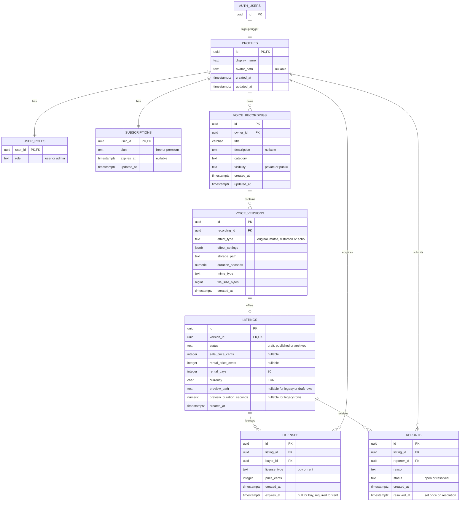

# EchoVault entity relationship diagram

This diagram follows the checked-in core migration and subsequent forward-only
migrations, including `listings.preview_duration_seconds`. There are **eight
public application tables**. Supabase's `auth.users` and Storage objects are
managed platform data; the Marketplace summary is a view, not a ninth application
table. Current remote schema parity is not established by this diagram.

## Tables and normalization

| Table | Purpose and relationship |
|---|---|
| `profiles` | Display identity without exposing Auth email. Its primary key also references `auth.users.id`. |
| `user_roles` | One stored authorization role per profile. Separating it from editable profile metadata prevents self-promotion. |
| `subscriptions` | One plan/expiry per profile. Premium is a subscription, independent of role. |
| `voice_recordings` | Recording identity, owner, title/category/description and metadata visibility. |
| `voice_versions` | Immutable original/effect output and its private object metadata. Many versions can share one recording. |
| `listings` | At most one offer per exact version, with demo euro-cent prices and separate public preview metadata. |
| `licenses` | A buyer's immutable purchase/rental receipt and historical price/expiry, linked to the listed version through the listing. |
| `reports` | Reporter evidence and review state for an offer. Resolving a report preserves its original reason and timestamps. |

The model avoids repeating seller/recording identity in licenses: those are
derived through listing → version → recording. `licenses.price_cents` is an
intentional historical price snapshot, so a receipt does not depend on a current
offer price. `effect_settings` stores effect-specific intensity metadata rather
than duplicating columns for each effect.

## Constraints and preservation

- Primary/foreign keys establish identity and referential integrity. Profile,
  role and subscription links cascade from Auth/profile deletion, but ownership,
  version, listing, license and report references use `ON DELETE RESTRICT`.
  Existing licensed media is therefore not silently removed through cascades.
- `voice_versions_one_original_per_recording` is a partial unique index for
  `effect_type = 'original'`. It enforces **at most one** original; the checked
  original-creation RPC supplies exactly one in its metadata transaction.
- `listings.version_id` is unique, including archived offers. Archival keeps
  the version relationship and existing licenses intact.
- `licenses_one_permanent_buy_per_listing` prevents duplicate permanent buys for
  the same buyer/listing. Rentals can have historical rows; the checkout RPC
  serializes active-rental retries and uses DB time rather than browser time.
- Prices are positive integers, at least one listing offer is required, currency
  is EUR and rent duration is 30 days. Buy receipts have null expiry; rentals
  require expiry. RPCs derive the actual timestamps and prices server-side.
- Report reason length is 1–1000 characters. Open reports have no resolution
  timestamp; resolved reports require one. A non-unique reporter/listing index
  preserves legacy duplicates while the report RPC prevents new duplicate pairs.
- All eight public tables enable RLS. Column grants, RLS policies, private helpers
  and protected RPCs work together; table relationships alone do not authorize
  access. Consult [architecture](architecture.md) and the focused SQL suites in
  `supabase/tests/` for the intended positive and negative cases.

`voice_versions.storage_path` and `listings.preview_path` reference object names
by validated text rather than SQL foreign keys into `storage.objects`. Checked
RPC/policy logic validates object ownership/metadata and protects referenced
objects from client cleanup. `marketplace_listing_summaries` deliberately omits
the private full-audio path.
